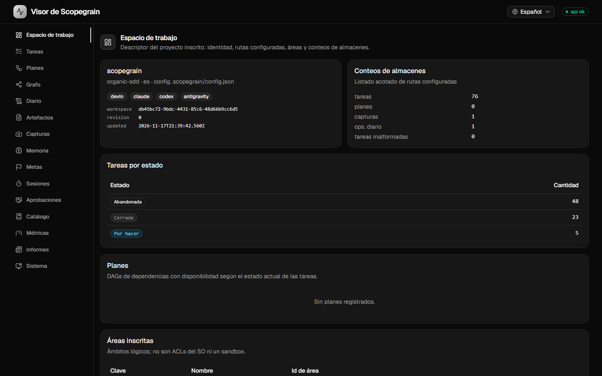
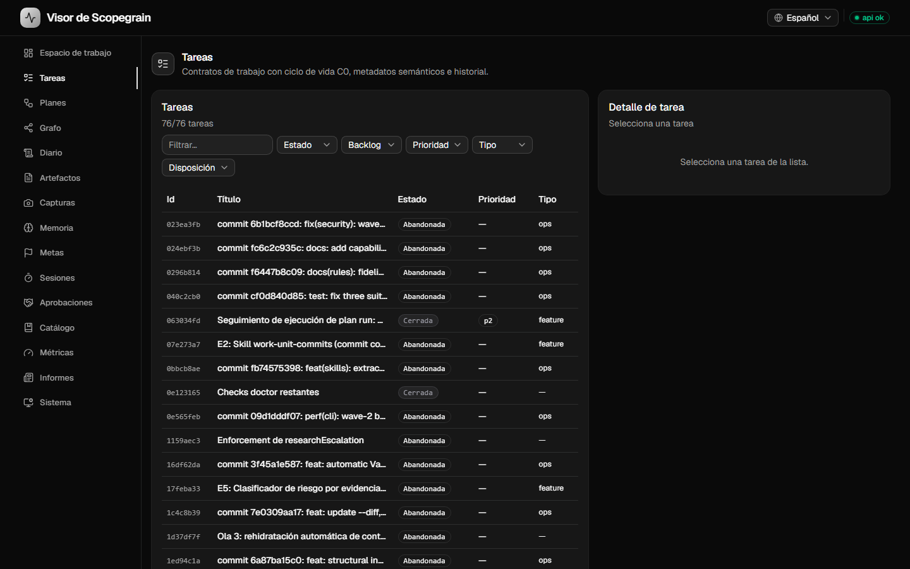

# Scopegrain

> Traduccion al espanol del README canonico en ingles (`README.md`). La
> version en ingles prevalece.

Harness portable de ingenieria proporcional para agentes de IA.

Scopegrain ayuda a equipos y operadores que usan agentes de codigo a
organizar trabajo entre proyectos y sesiones sin depender de un unico
anfitrion. Separa el contexto y los contratos de trabajo de las
convenciones de cada herramienta, y ofrece una ruta ligera o formal segun
los hechos y riesgos declarados.

### Por que Scopegrain

- **Portable entre agentes de codigo:** alterna entre Devin, Antigravity,
  Claude Code, Codex, OpenCode o hosts MCP genericos sin reescribir reglas
  del proyecto, historial de tareas ni contratos de verificacion.
- **Rigor proporcional (ODD):** los cambios acotados siguen una ruta ligera;
  los cambios riesgosos o ambiguos exigen automaticamente especificacion,
  diseno, aprobaciones HITL e informe de resultado.
- **Autoridad explicita e integridad fail-closed:** nada escribe sin
  `--apply`, los comandos descubiertos nunca se autoejecutan, locks/CAS y el
  journal local evitan corrupcion silenciosa y toda mutacion deja traza.
- **Visibilidad inmediata:** un visor web local de solo lectura
  (`scopegrain view`, 15 vistas, ES/EN) y un servidor MCP de 33 tools
  mantienen alineados a operadores y agentes sin salir del repositorio.

El producto se llama Scopegrain. `scopegrain` es la entrada CLI y el
nombre del servidor MCP (tools `scopegrain_*`). El alias de binario
`tasksystem` y las rutas legadas `.tasksystem` se mantienen por
compatibilidad.

## Para el operador humano

Scopegrain esta pensado para el agente: el agente de codigo consume el
paquete de sesion (`context`), las tools MCP y el resto de los verbos
CLI internamente. El operador humano no necesita aprender toda la
superficie de comandos — solo los verbos siguientes.

| Momento | Comando | Que hace |
|---|---|---|
| Defaults globales | `config show` / `config set` | Defaults globales opcionales de onboarding (`~/.config/scopegrain/config.json`); la config del workspace siempre prevalece |
| Primera adopcion | `init` | Onboarding interactivo: detecta el stack, pregunta donde ubicar cada categoria de archivos generados y muestra cada archivo antes de escribirlo |
| Chequeo de salud | `doctor` | Diagnostica configuracion, archivos generados, journal, stores, hooks, deps MCP, artefactos de usuario e integraciones — solo lectura, nunca repara en silencio |
| Reinvestigacion | `investigate --diff` | Compara la evidencia actual del proyecto con las decisiones de descubrimiento registradas y reporta que cambio |
| Estructura del codigo | `structure status` / `refresh` | Comprueba frescura stat-only o reconstruye el indice estructural solo si esta obsoleto (`context` sigue siendo solo lectura) |
| Panel | `view` | Lanza el dashboard web local de solo lectura (15 vistas, ES/EN); nunca muta estado |
| Verificacion | `verify approve` + `verify run` | Pone un comando de verificacion en lista blanca y luego ejecuta solo comandos aprobados con salida acotada |
| Decisiones | `approval answer` | Resuelve aprobaciones humanas pendientes |

## Visor web de solo lectura

Ejecuta `scopegrain view --project .` para inspeccionar tareas, planes DAG,
olas de ejecucion persistidas, metas, sesiones, aprobaciones, artefactos,
diario y salud del sistema en espanol o ingles. Consulta
[Visor y API de solo lectura](docs/viewer.md) para la matriz completa de que
puede/no puede hacer el usuario y los 29 endpoints.

- Video recorrido completo (EN + ES): [`docs/assets/viewer-walkthrough.webm`](docs/assets/viewer-walkthrough.webm)





Todo lo demas es maquinaria del agente. Limites que conviene conocer:

- Nada escribe sin `--apply` o una confirmacion explicita; no existe
  bypass `--yes`/`--force`.
- Los comandos descubiertos en los manifiestos del proyecto nunca se
  ejecutan.
- El acceso a red, `git push` y la activacion de fragmentos de host
  siempre requieren consentimiento explicito.
- El estado operativo vive bajo `.scopegrain/` por defecto
  (`.tasksystem/` sigue siendo una ruta legacy soportada); `context.md`
  ahi es el archivo de notas persistentes del owner — los agentes lo
  leen, no lo editan.
- El visor es de solo lectura por diseno; las mutaciones pasan por la
  CLI o las tools MCP bajo los gates del workflow.

## Flujo de trabajo

1. **Descubrimiento de solo lectura.** Inspeccionar manifiestos e
   instrucciones con limites de lectura; los comandos encontrados se
   presentan como propuestas y no se ejecutan automaticamente.
2. **Incorporacion y aprobacion.** Elegir anfitriones, metodologia, rutas y
   preferencias de versionado. Revisar la vista previa y confirmar antes de
   crear archivos. La aprobacion de archivos no autoriza otras operaciones.
3. **Contexto y snapshots.** Consultar el catalogo de procedimientos, roles,
   skills, reglas y perfiles. El proyecto conserva un snapshot de recursos
   para construir paquetes de contexto sin activar agentes.
4. **Tareas y planes proporcionales.** Registrar contratos, alcance y estado;
   organizar dependencias en un DAG. Organic Driven Development (ODD) usa
   una ruta ligera o SDD formal segun los hechos declarados.
5. **Evidencia, revision y aceptacion.** Registrar verificaciones y review
   o waiver. La ruta formal vincula especificacion, design, asignaciones,
   aprobaciones e informe vigente antes de aceptar una tarea.
6. **Continuidad y recuperacion.** Consultar el estado, reanudar sesiones
   registradas y diagnosticar recursos del snapshot sin repetir comandos ni
   activar trabajo automaticamente.

El descubrimiento no demuestra comprension semantica del codigo. La persona
o el agente debe investigar y decidir que verificaciones son apropiadas.
Las reglas del proyecto y los permisos del propietario prevalecen sobre las
sugerencias del harness.

## Inicio

Se requiere Node.js 22 o posterior. El CLI usa modulos nativos; el servidor
MCP opcional requiere las dependencias declaradas en `package.json`.

### Instalacion global (desde un clon local)

```powershell
npm install
npm link
scopegrain --version
```

### Inicio rapido en cualquier proyecto (3 comandos)

```powershell
scopegrain inspect --project "C:\ruta\mi-proyecto"
scopegrain init --project "C:\ruta\mi-proyecto"
scopegrain doctor --project "C:\ruta\mi-proyecto"
```

Sin enlace global, invoca `node ./bin/scopegrain.mjs ...` desde la raiz del
repositorio. Puedes guardar defaults globales opcionales de onboarding en
`~/.config/scopegrain/config.json` con `scopegrain config set --input FILE --apply`
(solo `locale`, `hosts`, `methodology`, `versioning`); **la configuracion del
workspace siempre prevalece** en runtime y re-init. Ver
[Incorporacion y personalizacion](docs/onboarding.md).

`inspect` no escribe ni ejecuta los comandos que descubre: es la
instantanea acotada de manifiestos que `init` guarda como
`discovery.json`. `investigate` es el analisis semantico profundo
(topologia, plataformas, pruebas, senales de anfitrion) que ademas
propone respuestas de init. `init` interactivo
pregunta por la configuracion, muestra los archivos propuestos y solicita
confirmacion explicita; la respuesta por defecto es no. `doctor` revisa el
estado de la configuracion y los archivos generados.

Tambien se puede usar un archivo de respuestas:

```powershell
node ./bin/tasksystem.mjs init --project "C:\ruta\mi-proyecto" --answers "C:\ruta\respuestas.json"
```

Con `--answers` y sin `--apply`, `init` solo presenta el plan. Agregar
`--apply` autoriza la creacion de los archivos propuestos, no la ejecucion
de comandos ni el reemplazo de contenido existente. `--yes` y `--force` no
son opciones de bypass. Las rutas de artefactos deben permanecer dentro del
proyecto; una configuracion alternativa se indica con `--config`.
La config predeterminada es `.scopegrain/config.json`; si solo existe
`.tasksystem/config.json`, se usa sin migrarla. Si existen ambas entradas,
se requiere `--config` explicito; una ruta explicita no tiene fallback.
Consultar el [ejemplo de respuestas](examples/answers.json) y su
[esquema](schemas/answers.schema.json).

Para operaciones del journal, consulte la
[guia de recuperacion explicita](docs/journal-recovery.md). Para notas de
captura tipadas con ownership probado, consulte
[capturas selectivas](docs/captures.md). Para la prueba de ownership
compartida de creaciones (`capture`, `spec`, `design` y `report`, todos
revision 0), consulte
[creacion con ownership probado](docs/record-ownership.md).
El CLI `specification create|show --owned` es opt-in explicito y conserva
el modo legacy por defecto. `design create` y `outcome create` tambien
aceptan `--owned` opcional; `design show` y `outcome show` lo requieren.
Sin ese flag, las creaciones conservan sus entradas y resultados legacy,
sin autodeteccion ni enrolamiento implicito. Las lecturas genericas
`artifact show design UUID` y `artifact show report UUID` siguen siendo
estructurales, no pruebas de ownership.

Los stores tipados `createOwnedDesignStore(ctx, { areaIds })` y
`createOwnedOutcomeStore(ctx, { areaIds })` reciben respectivamente
`{ areaIds, design }` y `{ areaIds, outcome }` y exponen `prepare`, `create`
y `get`. Requieren workspace enrolado y areas solicitadas explicitamente;
los grants locales para todas las areas no sustituyen la autorizacion
all-of. El design exige una spec V2 estructurada con binding de hash
valido, no ownership del padre. Crear un outcome exige una tarea formal
real en REVIEW, verification y bindings sanos; leer su report probado no
revalida la elegibilidad actual para ACCEPT. Los gates siguen evaluando
vigencia. No se activan productores, hooks ni integraciones nativas.

## Organic y SDD

La metodologia se selecciona al incorporar el proyecto:

| Modo | Uso |
| --- | --- |
| `manual` | Compatibilidad con tareas V1, sin migracion implicita. |
| `organic-sdd` | Ruta ligera o formal segun los hechos declarados. |
| `sdd` | Referencias formales para trabajo de cambio. |

Una configuracion antigua sin metodologia se interpreta como `manual` sin
reescribir sus bytes. En un proyecto interactivo nuevo se propone
`organic-sdd`, sujeto a confirmacion. Los controles de una tarea V2 no se
desactivan por cambiar el modo del proyecto a `manual`.

La clasificacion considera intencion, autorizacion, comprension,
incertidumbre, riesgo y continuidad declarados; no se basa en el numero de
lineas del diff. Una consulta de solo lectura no autoriza cambios. La
autorizacion ausente o rechazada, la comprension insuficiente, la
incertidumbre pendiente o el riesgo desconocido bloquean la ruta de cambio.
Una tarea ligera no requiere inventar artefactos formales.

En SDD, cada tarea formal, incluidas las preparatorias, necesita al menos un
escenario asignado. Un plan debe cubrir todos los escenarios de su
especificacion; las tareas comprueban sus propias asignaciones y sus
dependencias. ACT y ACCEPT revalidan las condiciones y aprobaciones
aplicables. Una consulta metodologica no sustituye permisos humanos ni
permisos del anfitrion. Ver [Organic y SDD](docs/methodology.md).

## Comandos y continuidad

```powershell
node ./bin/tasksystem.mjs catalog list command
node ./bin/tasksystem.mjs pipeline --project "C:\ruta\mi-proyecto" --mode plan
node ./bin/tasksystem.mjs plan create --project "C:\ruta\mi-proyecto" --input plan.json
node ./bin/tasksystem.mjs plan next entrega --project "C:\ruta\mi-proyecto"
```

Los aliases de workflow, como `pipeline`, `spec`, `audit` o `research`,
entregan procedimientos y contexto; no ejecutan modelos, agentes ni scripts.
Los planes guardan dependencias; los artefactos conservan especificaciones,
designs, informes y otros registros. Las sesiones registran operaciones y
presupuesto explicito; reanudarlas recupera contexto, no repite acciones.
Las creaciones JSON usan vista previa por defecto y requieren `--apply`;
las operaciones historicas de tarea mantienen su comportamiento previo.

La superficie CLI completa de un vistazo — cada verbo usa vista previa
por defecto y solo escribe con `--apply` (detalle: [referencia CLI](docs/cli-reference.md)):

| Area | Verbos |
|---|---|
| Descubrimiento y ciclo de vida | `inspect`, `investigate`, `init`, `adopt`, `update`, `backup`, `restore`, `uninstall`, `doctor` |
| Registros owned | `task *`, `plan *`, `session *`, `approval *`, `capture *`, `specification *`, `design *`, `outcome *`, `artifact *`, `workspace *`, `journal *` |
| Verificacion | `verify list`, `add`, `approve`, `approve-discovered`, `discover` (`--approve`), `run` (`--fail-on-error`) |
| Catalogo y recursos | `catalog list|show|check|legacy`, `resource search|diagnose|restore-plan|restore`, `methodology check`, `workflow` |
| Anfitriones y superficie | `host activate`, `view`, `mcp` |
| Aliases de catalogo | `pipeline`, `spec`, `audit`, `research`, `status`, `backlog`, `ship`, `rollback`, `harness`, `webperf`, `cleanCA`, `codeGraph`, `code-simplify` |

Los ejemplos antiguos de tareas y planes sin referencias formales
corresponden a `manual`; el ejemplo de respuestas incluido selecciona
`organic-sdd`. Consultar [workflows y continuidad](docs/workflows.md) y
[flujo de tareas](docs/task-workflow.md) antes de aplicar operaciones.

## Anfitriones y limites de confianza

Se generan propuestas para Claude Code, Codex, OpenCode V2, Devin Local/CLI,
Google Antigravity y Hermes Agent (provisional, formato sin verificar). Los
puentes nativos
y fragmentos MCP son propuestas para revision y activacion manual, no
integraciones certificadas — salvo los pilotos reales certificados de Devin
Local (2026-11-17), Antigravity App/CLI (2026-11-19) y OpenCode V2
(2026-11-23) — ni una garantia de
equivalencia de permisos o comportamiento. Devin Cloud no se considera
equivalente a Local/CLI. Ver [formatos nativos](docs/native-hosts.md).

- No hay ejecutor de modelos ni ejecucion automatica de agentes o SDK de
  anfitriones. Las instrucciones no son un sandbox ni interceptan todas las
  herramientas nativas.
- El MCP opcional es mayoritariamente de lectura: consultas mas un conjunto
  acotado de mutaciones journaled (escrituras de memoria/metas/disposicion y
  claim de tareas). No ejecuta shell. Los presupuestos cuentan operaciones
  registradas, no todas las llamadas del anfitrion, tokens ni gasto.
- Los hashes vinculan registros y evidencia declarada; no prueban ejecucion
  real, identidad de actores o revisores, ni el contenido completo del
  worktree. Una review independiente o waiver es una declaracion del proceso.
- Las comprobaciones de rutas y locks no constituyen una transaccion
  serializable entre todos los archivos ni aislamiento del sistema operativo.
  Los cuerpos libres pueden contener datos sensibles y deben revisarse antes
  de persistirse o compartirse.
- No se ejecutan automaticamente comandos descubiertos, instalaciones,
  publicaciones u operaciones Git. Ver el
  [modelo de seguridad](docs/security.md).

## Verificacion

La ultima ejecucion integral local (`npm test`, serial por archivo,
2026-11-22, commit `ca27e26`) termino con **1411 pruebas aprobadas**,
0 fallidas y 0 omitidas en Windows, Node.js v26.8.1 y npm 11.6.0, junto
con el carril del visor (**17/17 pruebas Vitest**, 0 errores de
lint/typecheck, build Vite en verde y auditoria visual Playwright de 30
pantallas EN/ES con 0 errores y 0 overflow). Las integrales
intermedias y las tandas anteriores son ejecuciones separadas; su alcance
y resultados historicos estan en [verificacion](docs/verification.md).
El piloto nativo de Devin Local quedo certificado en una sesion fresca
real el 2026-11-17 (42 skills `scopegrain-*` y 15 subagentes auto-cargados,
MCP `scopegrain` activo desde `.devin/mcp_config.json`); Antigravity se piloto el
2026-11-18 (activacion `.agents/` aplicada y consumida por su sesion de
agente). El piloto nativo de OpenCode V2 quedo certificado en una sesion
fresca real el 2026-11-23 contra `opencode v2.3.2`: 15/15 subagentes
`scopegrain-*` resueltos, 74 IDs de skill `scopegrain-*` deduplicados con
`.opencode/skills` ganando precedencia sobre `.agents/skills`,
`/scopegrain-status` expandiendo en el composer TUI, el MCP `scopegrain`
exponiendo 33 tools (27 read-only, 6 local-write) con
`scopegrain_status`/`catalog_list`/`list_tasks` invocados en vivo, el rol
read-only bloqueando `edit`/`shell` por ausencia de tool, la
interrupcion/reanudacion sin repetir efectos y la limpieza sin rastros en
la configuracion global de OpenCode. Claude, Codex, la superficie IDE de
Antigravity y el provisional Hermes siguen sin piloto nativo. Las pruebas
no certifican los seis anfitriones ni una ejecucion real del trabajo
declarado.
El [workflow de GitHub Actions](.github/workflows/verify.yml) se activa
solo
manualmente; su primera ejecucion remota completo con exito el 2026-11-18.

## Codigo y licencia

Licenciado bajo Apache License, Version 2.0 — ver [LICENSE](LICENSE),
[NOTICE](NOTICE) y [AUTHORS](AUTHORS). `package.json` declara los binarios
CLI instalables (`scopegrain`, `tasksystem`) y una lista acotada de archivos
(incluye `viewer/dist`; excluye `docs/assets` del tarball npm para mantener
la descarga por debajo de 1 MB). Cualquier publicacion en registros externos
requiere autorizacion explicita del propietario. El material heredado bajo
`legacy/` no forma parte del repositorio rastreado y permanece fuera de la
distribucion a la espera de una revision de licencias por pieza.

## Documentacion

- [Arquitectura](docs/architecture.md)
- [Incorporacion y personalizacion](docs/onboarding.md)
- [Compatibilidad y fuentes oficiales](docs/compatibility.md)
- [Seguridad y modelo de confianza](docs/security.md)
- [Migracion y limitaciones conocidas](docs/migration.md)
- [Destino de comandos, agentes, skills, reglas y referencias](docs/component-migration.md)
- [Flujo de tareas y evidencias](docs/task-workflow.md)
- [Organic, SDD, aprobaciones y limites de evidencia](docs/methodology.md)
- [Workflows y continuidad](docs/workflows.md)
- [Verificacion y reproduccion](docs/verification.md)
- [Capturas selectivas tipadas](docs/captures.md)
- [Creacion con ownership probado](docs/record-ownership.md)
- [Informe completo del sistema](docs/system-report.md)
- [Contrato del producto](docs/product-contract.md)
- [Contrato de implementacion](docs/implementation.md)
- [Ciclo de vida: adopt, update, backup, restore, uninstall](docs/lifecycle.md)
- [Referencia de la superficie CLI](docs/cli-reference.md)
- [Investigacion semantica acotada](docs/semantic-discovery.md)
- [Visor y API de solo lectura](docs/viewer.md)
- [Procedencia y atestacion del catalogo](docs/provenance.md)
