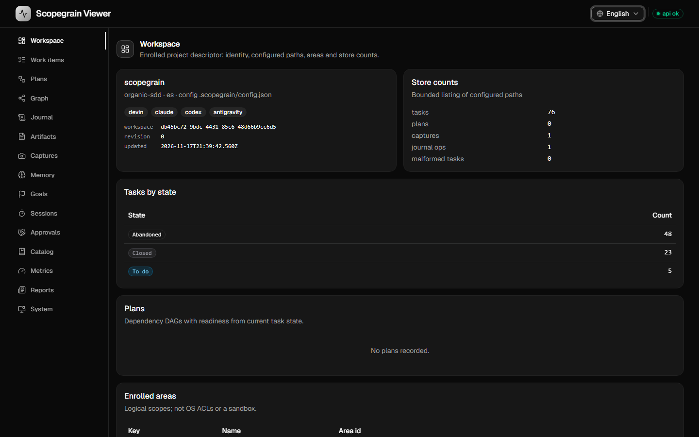
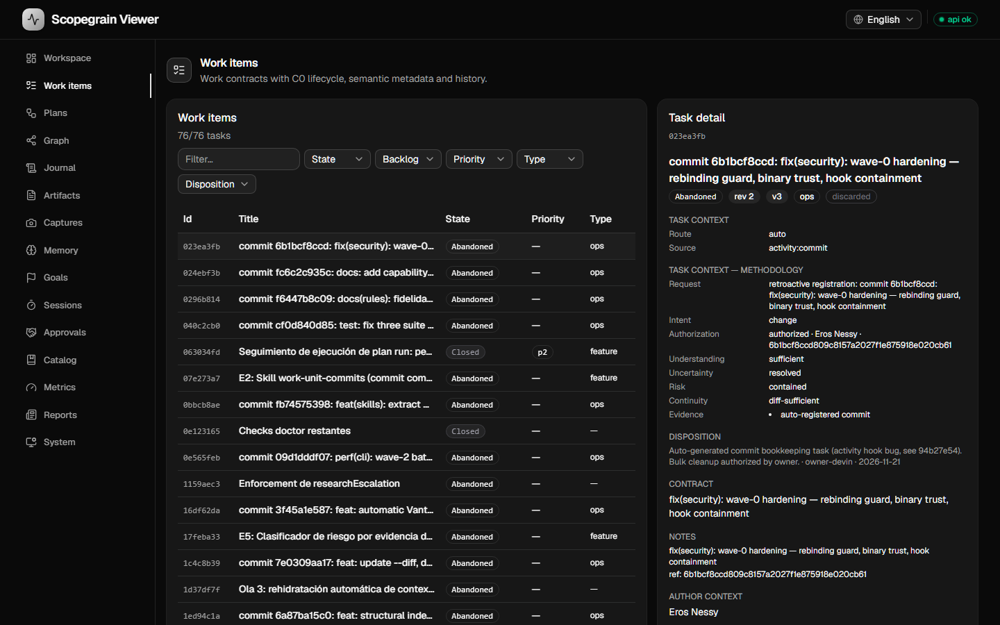

# Scopegrain

Portable proportional engineering harness for AI agents.

> Canonical README in English. Spanish translation: `README.es.md`.

Scopegrain helps teams and operators who use coding agents to organize
work across projects and sessions without depending on a single host. It
separates work context and contracts from each tool's conventions, and
offers a lightweight or formal route according to the declared facts and
risks.

### Why Scopegrain

- **Portable across coding agents:** switch between Devin, Antigravity,
  Claude Code, Codex, OpenCode or generic MCP hosts without rewriting
  project rules, task history or verification contracts.
- **Proportional rigor (ODD):** trivial/contained edits stay lightweight;
  risky or ambiguous changes gate automatically on structured specs,
  designs, HITL approvals and outcome reports.
- **Explicit authority, fail-closed integrity:** nothing writes without
  `--apply`, discovered manifest commands never auto-run, locks/CAS and a
  local journal prevent silent corruption, and every mutation leaves an
  auditable trail.
- **Instant visibility:** a local, read-only web dashboard (`scopegrain view`,
  15 views, EN/ES) and a 33-tool MCP server keep human operators and agents
  aligned without leaving the repository.

The product is called Scopegrain. `scopegrain` is the CLI entry point
and the MCP server name (`scopegrain_*` tools). The `tasksystem` binary
alias and legacy `.tasksystem` paths are kept for compatibility.

## For the human operator

Scopegrain is agent-first: the coding agent consumes the session packet
(`context`), the MCP tools and the remaining CLI verbs internally.
A human operator does not need to learn the full command surface —
only the verbs below.

| Moment | Command | What it does |
|---|---|---|
| Global defaults | `config show` / `config set` | Optional user onboarding defaults (`~/.config/scopegrain/config.json`); workspace config always wins |
| First adoption | `init` | Interactive onboarding: detects the stack, asks where each category of generated files should live, and shows every file before writing |
| Health check | `doctor` | Diagnoses configuration, generated files, journal, stores, hooks, MCP deps, user artifacts and optional integrations — read-only, never repairs silently |
| Re-investigation | `investigate --diff` | Compares the current project evidence with the recorded discovery decisions and reports what changed |
| Code structure | `structure status` / `refresh` | Checks freshness stat-only or rebuilds the persisted structural index when stale (`context` stays strictly read-only) |
| Dashboard | `view` | Starts the local, read-only web dashboard (15 views, EN/ES); it never mutates state |
| Verification | `verify approve` + `verify run` | Whitelists a verification command, then runs only approved commands with bounded output |
| Decisions | `approval answer` | Resolves pending human-in-the-loop approvals |

## Read-only web viewer

Run `scopegrain view --project .` to inspect tasks, DAG plans, persisted
execution waves, goals, sessions, approvals, artifacts, journal operations
and system health in English or Spanish. See
[Read-only viewer and API](docs/en/viewer.md) for the full what-you-can /
cannot-do matrix and all 29 endpoints.

- Walkthrough recording (EN + ES): [`docs/assets/viewer-walkthrough.webm`](docs/assets/viewer-walkthrough.webm)





Everything else is agent machinery. Boundaries worth knowing:

- Nothing writes without `--apply` or an explicit confirmation; there is
  no `--yes`/`--force` bypass.
- Commands discovered in project manifests are never executed.
- Network access, git push and host fragment activation always require
  explicit consent.
- Operational state lives under `.scopegrain/` by default
  (`.tasksystem/` remains a supported legacy path); `context.md` there is
  the owner's persistent notes file — agents read it, they do not edit it.
- The viewer is read-only by design; mutations go through the CLI or the
  MCP tools under the workflow gates.

## Workflow

1. **Read-only discovery.** Inspect manifests and instructions with read
   limits; discovered commands are presented as proposals and are not
   executed automatically.
2. **Onboarding and approval.** Choose hosts, methodology, paths and
   versioning preferences. Review the preview and confirm before files
   are created. Approving files does not authorize other operations.
3. **Context and snapshots.** Query the catalog of procedures, roles,
   skills, rules and profiles. The project keeps a snapshot of resources
   to build context packages without activating agents.
4. **Proportional tasks and plans.** Record contracts, scope and state;
   organize dependencies in a DAG. Organic Driven Development (ODD) uses
   a lightweight route or formal SDD according to the declared facts.
5. **Evidence, review and acceptance.** Record verifications and review
   or waiver. The formal route links specification, design, assignments,
   approvals and a current report before accepting a task.
6. **Continuity and recovery.** Query state, resume registered sessions
   and diagnose snapshot resources without repeating commands or
   activating work automatically.

Discovery does not demonstrate semantic understanding of the code. The
person or agent must investigate and decide which verifications are
appropriate. The project rules and the owner's permissions prevail over
the harness's suggestions.

## Getting started

Node.js 22 or later is required. The CLI uses native modules; the
optional MCP server requires the dependencies declared in
`package.json`.

### Install globally (from a local clone)

```powershell
npm install
npm link
scopegrain --version
```

### Quickstart on any project (3 commands)

```powershell
scopegrain inspect --project "C:\path\my-project"
scopegrain init --project "C:\path\my-project"
scopegrain doctor --project "C:\path\my-project"
```

Without a global link, invoke `node ./bin/scopegrain.mjs ...` from the
repository root. Optional user-level onboarding defaults can be saved at
`~/.config/scopegrain/config.json` with `scopegrain config set --input FILE --apply`
(`locale`, `hosts`, `methodology`, `versioning` only); **workspace config
always takes strict precedence** at runtime and re-init. See
[Onboarding and customization](docs/en/onboarding.md).

`inspect` neither writes nor executes the commands it discovers: it is
the bounded manifest snapshot `init` stores as `discovery.json`.
`investigate` is the deeper semantic analysis (topology, platforms,
tests, host signals) that additionally proposes init answers.
Interactive `init` asks for the configuration, shows the proposed files
and requests explicit confirmation; the default answer is no. `doctor`
checks the state of the configuration and the generated files.

An answers file can also be used:

```powershell
node ./bin/tasksystem.mjs init --project "C:\path\my-project" --answers "C:\path\answers.json"
```

With `--answers` and without `--apply`, `init` only presents the plan.
Adding `--apply` authorizes the creation of the proposed files, not the
execution of commands nor the replacement of existing content. `--yes`
and `--force` are not bypass options. Artifact paths must remain inside
the project; an alternative configuration is indicated with `--config`.
The default config is `.scopegrain/config.json`; if only
`.tasksystem/config.json` exists, it is used without migrating it. If
both entries exist, an explicit `--config` is required; an explicit path
has no fallback.
See the [answers example](examples/answers.json) and its
[schema](schemas/answers.schema.json).

For journal operations, see the
[explicit recovery guide](docs/en/journal-recovery.md). For typed capture
notes with proven ownership, see
[selective captures](docs/en/captures.md). For the shared ownership proof
of creations (`capture`, `spec`, `design` and `report`, all revision 0),
see
[creation with proven ownership](docs/en/record-ownership.md).
The `specification create|show --owned` CLI is explicit opt-in and keeps
the legacy mode by default. `design create` and `outcome create` also
accept optional `--owned`; `design show` and `outcome show` require it.
Without that flag, creations keep their legacy inputs and results, with
no auto-detection or implicit enrollment. The generic reads
`artifact show design UUID` and `artifact show report UUID` remain
structural, not ownership proofs.

The typed stores `createOwnedDesignStore(ctx, { areaIds })` and
`createOwnedOutcomeStore(ctx, { areaIds })` respectively receive
`{ areaIds, design }` and `{ areaIds, outcome }` and expose `prepare`,
`create` and `get`. They require an enrolled workspace and explicitly
requested areas; local grants for all areas do not substitute the
all-of authorization. The design requires a structured V2 spec with a
valid hash binding, not parent ownership. Creating an outcome requires
a real formal task in REVIEW, a verification and healthy bindings;
reading its proven report does not revalidate current eligibility for
ACCEPT. The gates keep evaluating validity. No producers, hooks or
native integrations are activated.

## Organic and SDD

The methodology is selected when onboarding the project:

| Mode | Use |
| --- | --- |
| `manual` | Compatibility with V1 tasks, no implicit migration. |
| `organic-sdd` | Lightweight or formal route according to the declared facts. |
| `sdd` | Formal references for change work. |

An old configuration without a methodology is interpreted as `manual`
without rewriting its bytes. A new interactive project is offered
`organic-sdd`, subject to confirmation. A V2 task's controls are not
disabled by switching the project mode to `manual`.

Classification considers declared intent, authorization, understanding,
uncertainty, risk and continuity; it is not based on the number of diff
lines. A read-only query does not authorize changes. Missing or rejected
authorization, insufficient understanding, pending uncertainty or
unknown risk block the change route. A lightweight task does not require
inventing formal artifacts.

In SDD, every formal task, including preparatory ones, needs at least
one assigned scenario. A plan must cover all the scenarios of its
specification; tasks check their own assignments and their dependencies.
ACT and ACCEPT revalidate the applicable conditions and approvals. A
methodology query does not substitute human permissions or host
permissions. See [Organic and SDD](docs/en/methodology.md).

## Commands and continuity

```powershell
node ./bin/tasksystem.mjs catalog list command
node ./bin/tasksystem.mjs pipeline --project "C:\path\my-project" --mode plan
node ./bin/tasksystem.mjs plan create --project "C:\path\my-project" --input plan.json
node ./bin/tasksystem.mjs plan next entrega --project "C:\path\my-project"
```

Workflow aliases, such as `pipeline`, `spec`, `audit` or `research`,
deliver procedures and context; they do not execute models, agents or
scripts. Plans store dependencies; artifacts keep specifications,
designs, reports and other records. Sessions register operations and an
explicit budget; resuming them recovers context, it does not repeat
actions. JSON creations use preview by default and require `--apply`;
historic task operations keep their previous behavior.

The full CLI surface at a glance — every verb previews by default and
writes only with `--apply` (detail: [CLI reference](docs/en/cli-reference.md)):

| Area | Verbs |
|---|---|
| Discovery and lifecycle | `inspect`, `investigate`, `init`, `adopt`, `update`, `backup`, `restore`, `uninstall`, `doctor` |
| Owned records | `task *`, `plan *`, `session *`, `approval *`, `capture *`, `specification *`, `design *`, `outcome *`, `artifact *`, `workspace *`, `journal *` |
| Verification | `verify list`, `add`, `approve`, `approve-discovered`, `discover` (`--approve`), `run` (`--fail-on-error`) |
| Catalog and resources | `catalog list|show|check|legacy`, `resource search|diagnose|restore-plan|restore`, `methodology check`, `workflow` |
| Hosts and surface | `host activate`, `view`, `mcp` |
| Catalog aliases | `pipeline`, `spec`, `audit`, `research`, `status`, `backlog`, `ship`, `rollback`, `harness`, `webperf`, `cleanCA`, `codeGraph`, `code-simplify` |

Old task and plan examples without formal references correspond to
`manual`; the included answers example selects `organic-sdd`. See
[workflows and continuity](docs/en/workflows.md) and
[task flow](docs/en/task-workflow.md) before applying operations.

## Hosts and trust boundaries

Proposals are generated for Claude Code, Codex, OpenCode V2, Devin
Local/CLI, Google Antigravity and Hermes Agent (provisional, unverified
format). Native bridges and MCP fragments are
proposals for review and manual activation, not certified integrations —
except the certified Devin Local (2026-11-17), Antigravity App/CLI
(2026-11-19) and OpenCode V2 (2026-11-23) real-session pilots — or a
guarantee of permission or behavior equivalence. Devin Cloud is not
considered equivalent to Local/CLI. See
[native formats](docs/en/native-hosts.md).

- There is no model executor and no automatic execution of agents or
  host SDKs. The instructions are not a sandbox and do not intercept
  every native tool.
- The optional MCP is read-mostly: queries plus a small set of bounded
  journaled mutations (memory/goal/disposition writes and task claiming).
  It does not execute shell. Budgets count registered operations, not
  every host call, tokens or spend.
- Hashes bind records and declared evidence; they do not prove actual
  execution, actor or reviewer identity, or the full content of the
  worktree. An independent review or waiver is a process declaration.
- Path checks and locks do not constitute a serializable transaction
  across all files or operating-system isolation. Free-text bodies may
  contain sensitive data and must be reviewed before being persisted or
  shared.
- Discovered commands, installations, publications or Git operations are
  not executed automatically. See the
  [security model](docs/en/security.md).

## Verification

The most recent local full run (`npm test`, per-file serial, 2026-11-22,
commit `ca27e26`) finished with **1411 passing tests**, 0 failed and 0
skipped on Windows, Node.js v26.8.1 and npm 11.6.0, alongside the
viewer lane (**17/17 Vitest tests**, 0 lint/typecheck errors, Vite build
passing, and a 30-screen EN/ES Playwright visual audit with 0 errors and
0 overflow). Intermediate full runs and earlier batches are separate
executions; their scope and historic results are in
[verification](docs/en/verification.md). The Devin Local native pilot was
certified in a fresh real session on 2026-11-17 (42 `scopegrain-*` skills
and 15 subagents auto-loaded, `scopegrain` MCP active from
`.devin/mcp_config.json`); the Antigravity App/CLI native pilot was
certified in a fresh real session on 2026-11-19 (72 `scopegrain-*` skills
and 15 subagents auto-discovered, `scopegrain` MCP active from
`.agents/mcp_config.json`, with live `scopegrain_status` and
`scopegrain_catalog_list` invocations). The OpenCode V2 native pilot was
certified in a fresh real session on 2026-11-23 against `opencode v2.3.2`:
15/15 `scopegrain-*` subagents resolved, 74 de-duplicated `scopegrain-*`
skill IDs with `.opencode/skills` winning precedence over `.agents/skills`,
`/scopegrain-status` expanding in the TUI composer, the `scopegrain` MCP
exposing 33 tools (27 read-only, 6 local-write) with
`scopegrain_status`/`catalog_list`/`list_tasks` invoked live, the read-only
role blocking `edit`/`shell` by tool absence, interruption/resumption
repeating no effects, and cleanup leaving no traces in the global OpenCode
config. Claude, Codex, the Antigravity IDE
surface and the provisional Hermes still lack a native pilot. The tests do
not certify the six hosts or a real execution of the declared work.
The [GitHub Actions workflow](.github/workflows/verify.yml) is triggered
manually only; its first remote run completed successfully on 2026-11-18.

## Code and license

Licensed under the Apache License, Version 2.0 — see [LICENSE](LICENSE),
[NOTICE](NOTICE) and [AUTHORS](AUTHORS). `package.json` declares the
installable CLI binaries (`scopegrain`, `tasksystem`) and bounded file
list (`viewer/dist` included; `docs/assets` excluded from npm tarballs to
keep installs under 1 MB). Publication to any external registry requires
explicit owner authorization. The inherited material under `legacy/` is
not part of the tracked repository and remains outside the distribution
pending per-piece license review.

## Documentation

- [Architecture](docs/en/architecture.md)
- [Onboarding and customization](docs/en/onboarding.md)
- [Compatibility and official sources](docs/en/compatibility.md)
- [Security and trust model](docs/en/security.md)
- [Migration and known limitations](docs/en/migration.md)
- [Destination of commands, agents, skills, rules and references](docs/en/component-migration.md)
- [Task flow and evidence](docs/en/task-workflow.md)
- [Organic, SDD, approvals and evidence boundaries](docs/en/methodology.md)
- [Workflows and continuity](docs/en/workflows.md)
- [Verification and reproduction](docs/en/verification.md)
- [Typed selective captures](docs/en/captures.md)
- [Creation with proven ownership](docs/en/record-ownership.md)
- [Complete system report](docs/en/system-report.md)
- [Product contract](docs/en/product-contract.md)
- [Implementation contract](docs/en/implementation.md)
- [Lifecycle: adopt, update, backup, restore, uninstall](docs/en/lifecycle.md)
- [CLI surface reference](docs/en/cli-reference.md)
- [Bounded semantic investigation](docs/en/semantic-discovery.md)
- [Read-only viewer and API](docs/en/viewer.md)
- [Catalog provenance and attestation](docs/en/provenance.md)
