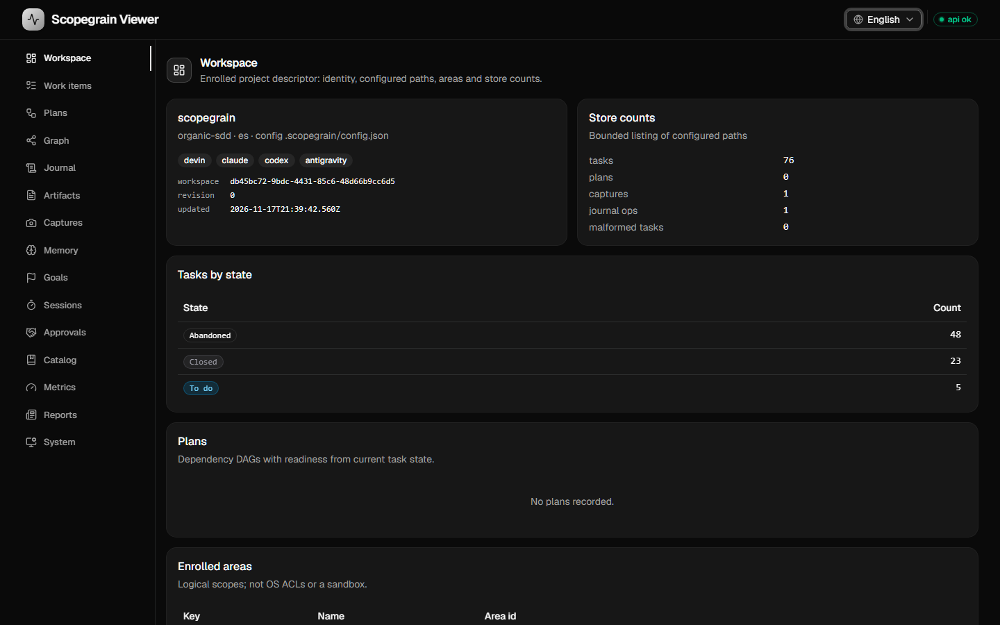
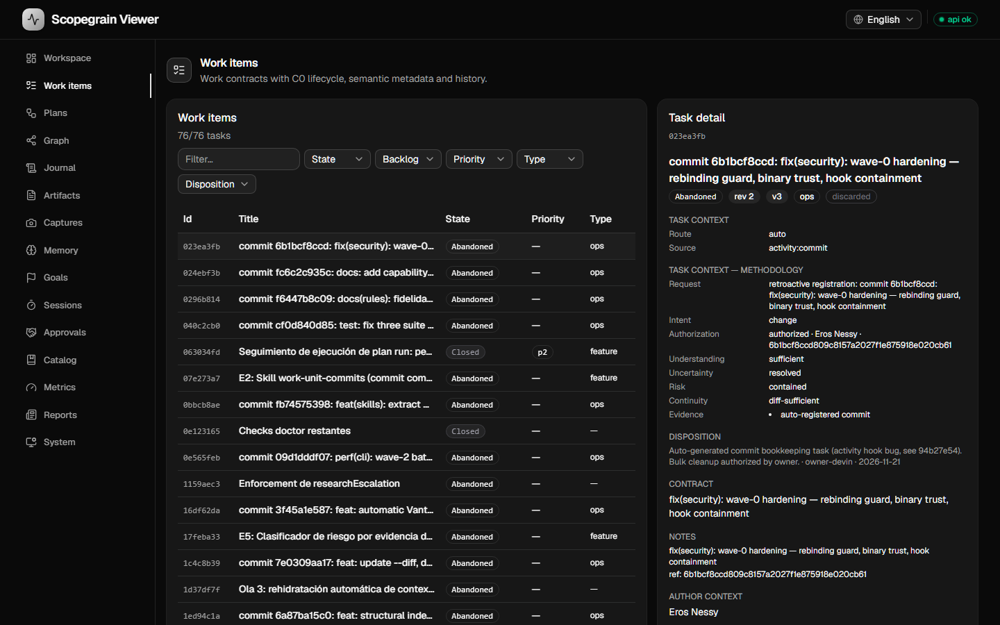
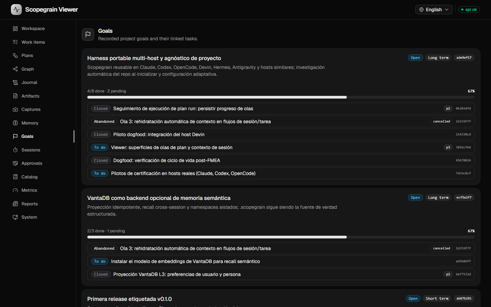
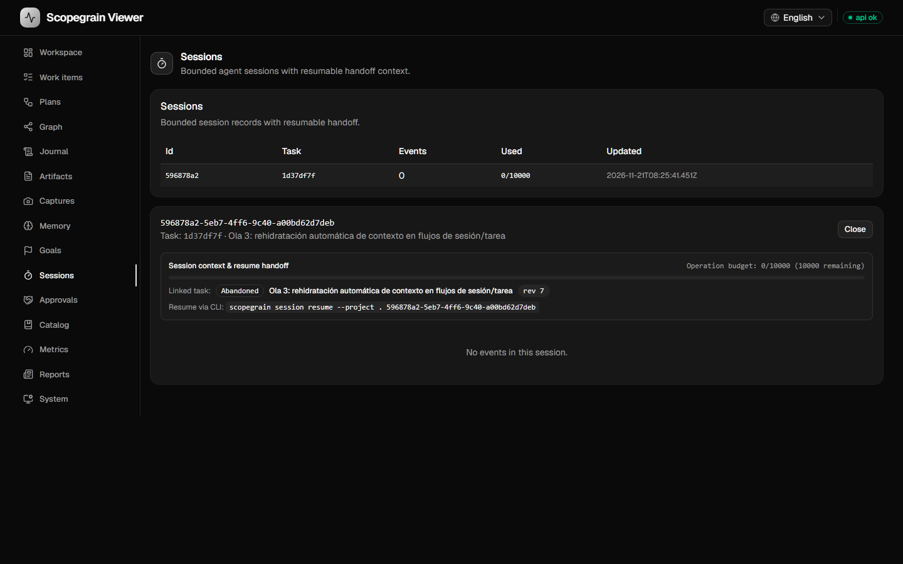
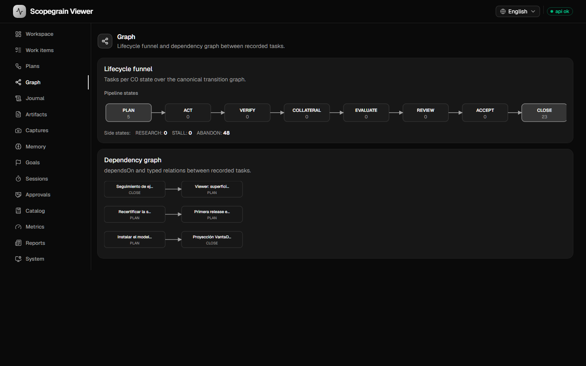

# Viewer (block G)

> English translation of the canonical Spanish document
> (`../viewer.md`). The Spanish version prevails.

Read-only (by default) local viewer for Scopegrain stores. Two pieces:

- `src/api/` - a localhost-only JSON API over the configured stores
  (`node:http`, zero dependencies, GET-only).
- `viewer/` - a self-contained Vite + React + TypeScript + Tailwind +
  shadcn/ui package that renders the API data.

The API exposes what already exists on disk through the core getters and
store locations. It does not adopt files, execute commands or activate
hosts. The explicit `--allow-write` opt-in enables one bounded write
channel (the catalog document edit described below); without it the API
stays strictly GET. It is a local convenience surface, not a production
host: there is no authentication beyond the loopback bind, no multi-user
model and no TLS. Do not expose the port.

## Running

```powershell
scopegrain view --project PATH [--host 127.0.0.1|::1] [--port N] [--allow-write]
```

`--allow-write` (opt-in): enables `PUT /api/catalog/:kind/:id`, the
bounded edit of a catalog entry's projected file. The body is
`{content, expectedSha256}`: `expectedSha256` must equal the sha256 of
the file's current bytes (CAS; divergence → 409 `WRITE_CONFLICT`) and
`content` shares the document byte cap (`maxDocumentBytes`; over → 422
`DOCUMENT_TOO_LARGE`). The write is atomic (exclusive temp + fsync +
rename inside the configDir, no symlinks) and, once applied, the entry's
`sha256` pin is updated in `catalog.json` (or `mounted-catalog.json` for
bundle-mounted entries) so the snapshot still verifies. A later `update`
reports the file as diverged from the install catalog: edits are never
silently reverted; `update --reconcile` is the owner's explicit revert.
Without the flag, PUT answers 403 `WRITE_DISABLED`.

`view` starts the loopback API and, when the viewer build ships with the
package (`viewer/dist`), mounts it same-origin: `/` serves the SPA with
`index.html` fallback for client paths, hashed assets under `/assets/`
are cache-immutable, and traversal escapes are rejected. Without a build
present the API alone still answers under `/api`.

Started from the module:

```js
import { createApiServer } from './src/api/server.mjs';

const api = createApiServer({
  project: 'C:/path/to/project',   // explicit project root (required)
  config: '.scopegrain/config.json', // optional project-relative override
  host: '127.0.0.1',               // default; loopback only
  port: 7731,                      // default; 0 = ephemeral
});
const { host, port } = await api.listen();
// ... await api.close();
```

`createApiServer` resolves the context eagerly, so a bad project or config
fails before the socket opens. The host must be the literal `127.0.0.1`
or `::1`; `localhost`, `0.0.0.0`, `::` and any other name throw
`INVALID_HOST` before
binding. The workspace binding used by journal and capture endpoints is
the same all-areas grant the local CLI uses.

Viewer (development):

```powershell
cd viewer
npm install
npm run dev          # http://127.0.0.1:5173, /api proxied to the API
```

The Vite dev server proxies `/api` to `VITE_API_TARGET`
(default `http://127.0.0.1:7731`), so no CORS is needed or granted.
`npm run build` typechecks (`tsc --noEmit`) and emits `dist/`; `npm run
typecheck` runs the type gate alone.

## Endpoints

All responses are JSON. Errors use `{error:{code,message}}` with matching
HTTP status: `*_NOT_FOUND` 404, `INVALID_*`/`UNKNOWN_*` 400,
`*_MALFORMED`/`*_DRIFT`/`DOCUMENT_TOO_LARGE` 422,
`SCOPE_DENIED`/`WRITE_DISABLED` 403, `*_CONFLICT`/`WORKSPACE_STALE` 409,
anything else 500. Non-GET methods on any path return 405 (PUT to the
catalog endpoint without `--allow-write` returns 403 `WRITE_DISABLED`);
unknown paths 404; unknown query parameters 400.

| Endpoint | Payload |
| --- | --- |
| `GET /api/health` | `{status, api, schemaVersion, serverTime}` |
| `GET /api/workspace` | project summary, workspace descriptor (or `null` when not enrolled), store counts, areas |
| `GET /api/tasks?limit=&offset=` | task summaries + `malformed[]` + `truncated` |
| `GET /api/tasks/:id` | full task record (`contract`/`authorContext` capped) |
| `GET /api/tasks/:id/doc` | rendered task document (`<paths.tasks>/<uuid>.md` via `task doc`) or `doc: null` |
| `GET /api/plans` | plans + per-task readiness (or `readinessError`) + `malformed[]` |
| `GET /api/plan-docs` | plan file listing (`<paths.plans>/*.md`: name, bytes, updatedAt) |
| `GET /api/plan-docs/:name` | plan file contents (`*.md` slug resolved inside the plans dir) |
| `GET /api/plans/:key` | plan document + readiness + execution `waves` + persisted `runState` |
| `GET /api/artifact-docs?kind=` | loose `.md` documents per kind (canonical + legacy `.scopegrain/<kind>/` dirs): name, title, status, date, bytes |
| `GET /api/artifact-docs/:kind/:name` | artifact document contents (`*.md` slug bounded to the kind's dirs) |
| `GET /api/artifacts?kind=&limit=&offset=` | `kind` required, one of `spec design report research decision lesson handoff review` |
| `GET /api/artifacts/:kind/:id` | artifact document (`body` capped) |
| `GET /api/journal/operations?limit=&offset=` | operation summaries: `state`, `eventCount`, `sourceKinds`, `recordIds` |
| `GET /api/journal/operations/:id` | full intent with events + recovery receipt |
| `GET /api/captures?limit=&offset=` | per-capture `status` + `ownershipConfirmed` + scoped record or error |
| `GET /api/memory` | bounded JSONL worklogs (`lessons`, `outcomes`, `progress`, `activity`) |
| `GET /api/goals` | project goals + linked tasks and completion progress |
| `GET /api/metrics` | aggregates by state/backlog/priority/type/disposition and verification rates |
| `GET /api/reports` / `GET /api/reports/:name` | saved status reports from `report save` |
| `GET /api/sessions` / `GET /api/sessions/:id` | bounded sessions + `resumeContext` (linked task, budget bar, CLI resume command) |
| `GET /api/approvals` / `GET /api/approvals/:id` | HITL approval queue and answer/revocation detail |
| `GET /api/catalog` | workspace resource catalog and hash verification |
| `GET /api/catalog/:kind/:id` | projected file body of a catalog entry (confined to configDir, bounded, `sha256` included); resolves aliases; `writable` reports whether PUT is enabled for this doc |
| `PUT /api/catalog/:kind/:id` | projected file edit, only with `--allow-write`: `{content, expectedSha256}` → `{kind,id,path,sha256,applied}`; CAS 409 `WRITE_CONFLICT`, 403 `WRITE_DISABLED` |
| `GET /api/verify` | discovered and approved verification commands |
| `GET /api/vantadb` | VantaDB enrollment status (never spawns binary) |
| `GET /api/workflow` | canonical state machine and allowed transitions |

Journal operation `state` values: `committed`, `prepared` (unconfirmed),
`abandoned`. Capture `status` values:

| status | meaning |
| --- | --- |
| `proved` | sidecar canonical + committed two-event operation + current bytes equal the snapshot |
| `drifted` | current source bytes differ from the proved snapshot (`CAPTURE_SOURCE_CHANGED`) |
| `unconfirmed` | owning operation is not committed (`CAPTURE_NOT_COMMITTED`) |
| `unproved` | no ownership proof found (`CAPTURE_NOT_FOUND`) |
| `malformed` | proof or record failed validation (`CAPTURE_MALFORMED`) |
| `error` | any other read failure |

## Bounds

- `limit` defaults to 200, max 500; `offset` is a non-negative integer.
- Directory scans cap at 501 entries; beyond that the response carries
  `truncated: true`.
- Artifact `body` truncates at 16384 chars with `[truncated by api]` and a
  `bodyTruncated` flag; capture `summary` at 4096; task `contract`/
  `authorContext`/`title` at 2048.
- Malformed entries are surfaced in `malformed[]` (`file` + `{code,
  message}`), never silently dropped - same contract as `listTasks`.
- Request URIs over 4096 bytes return 414. Request bodies are only read
  on the opt-in PUT channel: bounded JSON (`maxDocumentBytes` plus a
  small envelope allowance; over → 422); every other request never reads
  a body.

The API reads only inside the configured store paths
(`paths.tasks/plans/reports/research/decisions/memory/state`); no dynamic
filesystem access derives from request input beyond UUID/slug validation.

## Non-goals

- No writes beyond the opt-in bounded catalog-document edit channel
  (`--allow-write`); nothing else mutates. No recovery actions, ack
  submission or previews.
- No authentication, authorization or multi-user isolation. The loopback
  bind is the entire access boundary; the API is not a production host.
- No websockets or push - the viewer polls/refreshes.
- No adoption of plausible files: reads go through the same strict
  getters/ownership proofs as the CLI; malformed stored data surfaces as
  errors, not guesses.
- Workspace-scoped endpoints (`journal`, `captures`) return
  `WORKSPACE_NOT_FOUND` (404) on unenrolled projects; `/api/workspace`
  still answers with `workspace: null`.

## UI capabilities (what a user can and cannot do)

The viewer is **read-only by design** (loopback-only, GET-only, no authentication). The single opt-in exception is catalog document editing, available only when the API was started with `--allow-write`. It supports instant **English / Español** language switching from the top bar with 100% key parity.

### What users CAN do across the 15 views

| View | Inspected data & read-only interactions |
|---|---|
| **Workspace** | Project identity, active methodology, configured hosts, store counts, tasks by state, plan readiness and enrolled logical areas. |
| **Work items (`Tasks`)** | Combined filters (text, state, backlog, priority, type, disposition); full task detail with contract, methodology assessment (`request`, `authorization`, `understanding`, `uncertainty`, `risk`, `continuity`, `evidence`), verification, review, steps, dependencies, notes, history and rendered Markdown doc. |
| **Plans** | Semantic DAG plans (status, progress %, `specId`/`designId`, `appetite`, `cynefin`, per-task readiness, dependencies, clickable wave task chips, persisted `runState` checkpoints) and rendered Markdown plan files (`*.md`). |
| **Graph** | C0 lifecycle funnel (`PLAN → ACT → VERIFY → COLLATERAL → EVALUATE → REVIEW → ACCEPT → CLOSE` + `RESEARCH`/`STALL`/`ABANDON`) and SVG task dependency graph. |
| **Goals** | Open/achieved/dropped goals, horizon, progress bars and clickable linked tasks per goal. |
| **Sessions** | Bounded operation-budget sessions; detail card includes `resumeContext` (linked task state/refs, budget progress bar, last action, exact `session resume` CLI command). |
| **Approvals** | HITL digest-bound approval queue, scoped paths and answer/revocation history. |
| **Artifacts** | Per-kind tabs (`spec`, `design`, `report`, `research`, `decision`, `lesson`, `handoff`, `review`) covering both structured JSON artifacts with bindings and Markdown documents. |
| **Journal** | Journal operations (`committed`/`prepared`/`abandoned`), event lists, hashes and recovery receipts. |
| **Captures** | Selective capture notes with ownership proof status (`proved`, `drifted`, `unconfirmed`, `unproved`, `malformed`) and area scopes. |
| **Memory** | JSONL worklogs (`progress`, `lessons`, `outcomes`, `activity`) with commit and task links. |
| **Catalog** | Projected workspace resources (commands, agents, skills, rules, references, prompts, profiles) and hash integrity. With `--allow-write` on the API: CAS (`expectedSha256`) editing of the projected document, 409 conflict notice with reload; the manifest `sha256` pin updates on save. |
| **Metrics** | Store breakdowns by state/backlog/priority/type/disposition and verification rates. |
| **Reports** | Historical status snapshots saved via `report save`. |
| **System** | Human operator essentials, live C0 workflow state machine, VantaDB enrollment status and approved/discovered verification commands. |

### What users CANNOT do from the UI (and the CLI/MCP equivalent)

| Mutating action | Why it is outside the UI | CLI / MCP equivalent |
|---|---|---|
| Create or transition tasks | Transitions enforce CAS, evidence and methodology gates | `scopegrain task create` / `scopegrain task transition` |
| Create plans or persist wave checkpoints | Writes require explicit `--apply` | `scopegrain plan create --apply` / `scopegrain plan run KEY --apply` |
| Answer HITL approvals | Answers bind content digests and explicit actors | `scopegrain approval answer --apply` |
| Approve or run verification commands | Manual whitelist execution, never triggered from a browser | `scopegrain verify approve --apply` / `scopegrain verify run ID` |
| Activate hosts, hooks, VantaDB or recover journal | Privileged workspace mutations | `host activate`, `hooks install`, `vantadb setup`, `journal recover` |

## Screenshots and recorded walkthrough

Verified in headless Chromium (1440×900 desktop & 390×844 mobile, 0 console/page/HTTP errors, 0 horizontal overflow):

- Full walkthrough video (EN + ES): [`../assets/viewer-walkthrough.webm`](../assets/viewer-walkthrough.webm)
- Workspace (EN): 
- Work items & detail (EN): 
- Goals & linked tasks (EN): 
- Session context & resume handoff (EN): 
- Lifecycle funnel & dependency graph (EN): 

## Viewer structure

```text
viewer/
  src/lib/api.ts       typed client mirroring the 30 GET endpoints
                       + the opt-in catalog-edit PUT
  src/lib/i18n.ts      EN/ES dictionaries with 100% key parity
  src/lib/useApi.ts    loading/error/reload fetch hook
  src/components/ui/   shadcn/ui components
  src/components/      StatusBits, ErrorBoundary, Markdown, PlansCard, viz
  src/views/           15 views (Workspace, Tasks, Plans, Graph, Journal,
                       Artifacts, Captures, Memory, Goals, Sessions,
                       Approvals, Catalog, Metrics, Reports, System)
```
