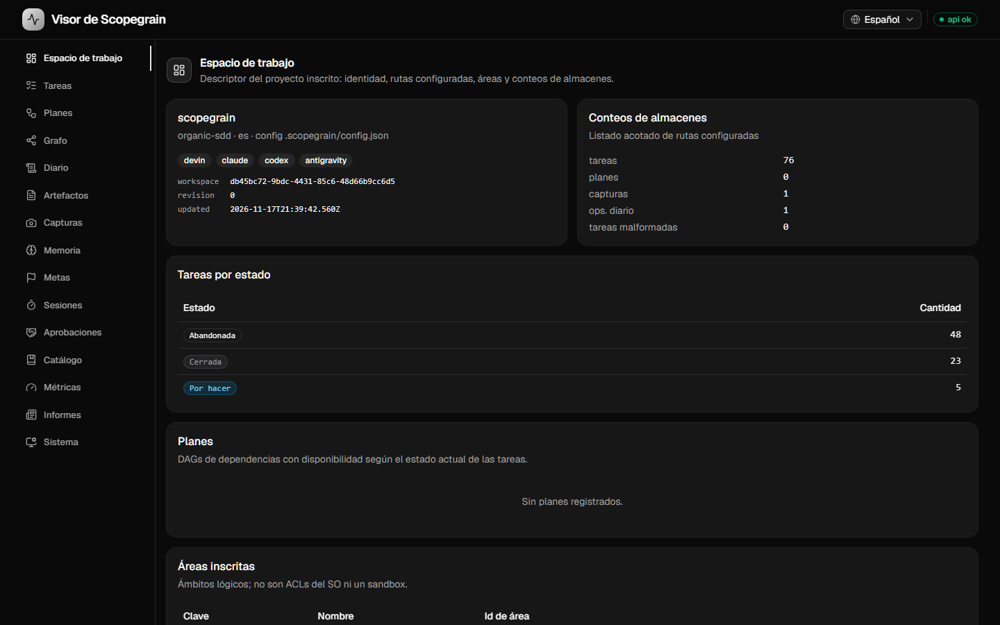
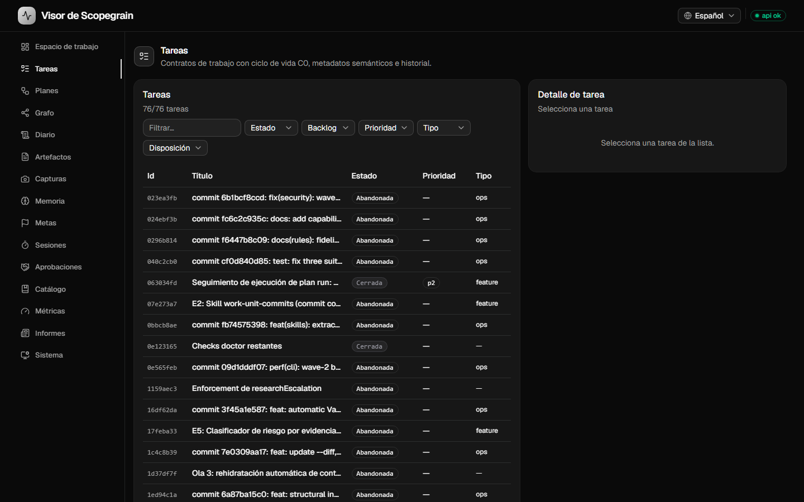
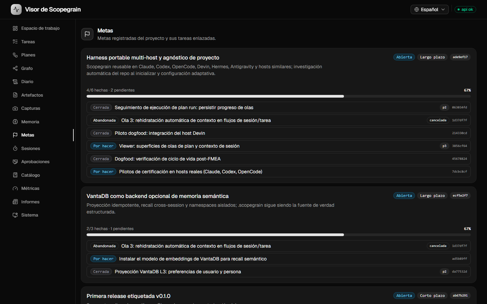
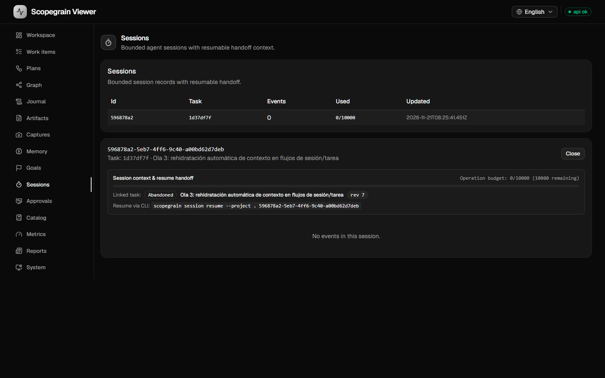
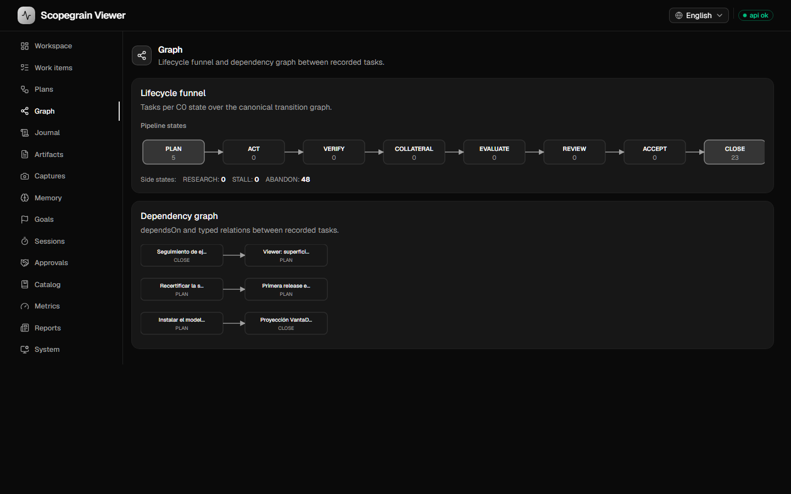

# Visor (bloque G)

Visor local de solo lectura (por defecto) para los stores de Scopegrain.
Dos piezas:

- `src/api/` - una API JSON solo-localhost sobre los stores configurados
  (`node:http`, cero dependencias, solo GET).
- `viewer/` - un paquete autocontenido Vite + React + TypeScript +
  Tailwind + shadcn/ui que renderiza los datos de la API.

La API expone lo que ya existe en disco a traves de los getters del core
y las ubicaciones de los stores. No adopta archivos, no ejecuta comandos
ni activa hosts. Con el opt-in explicito `--allow-write` habilita un
unico canal de escritura acotado (la edicion de documentos del catalogo,
descrita abajo); sin el, la API sigue siendo estrictamente GET. Es una
superficie de conveniencia local, no un host de produccion: no hay
autenticacion mas alla del bind a loopback, no hay modelo multi-usuario
ni TLS. No exponer el puerto.

## Ejecucion

```powershell
scopegrain view --project PATH [--host 127.0.0.1|::1] [--port N] [--allow-write]
```

`--allow-write` (opt-in): habilita `PUT /api/catalog/:kind/:id`, la
edicion acotada del archivo proyectado de una entrada del catalogo. El
body es `{content, expectedSha256}`: `expectedSha256` debe igualar el
sha256 de los bytes actuales del archivo (CAS; divergencia → 409
`WRITE_CONFLICT`) y `content` comparte el tope de bytes de los documentos
(`maxDocumentBytes`; exceso → 422 `DOCUMENT_TOO_LARGE`). La escritura es
atomica (temp exclusivo + fsync + rename dentro del configDir, sin
symlinks) y, al aplicarse, el pin `sha256` de la entrada se actualiza en
`catalog.json` (o `mounted-catalog.json` para entradas de bundles) para
que el snapshot siga verificando. El siguiente `update` reporta el
archivo como divergente del catalogo de instalacion: las ediciones nunca
se revierten solas; `update --reconcile` es el revert explicito del
owner. Sin el flag, PUT responde 403 `WRITE_DISABLED`.

`view` inicia la API de loopback y, cuando el build del visor se
distribuye con el paquete (`viewer/dist`), lo monta en el mismo origen:
`/` sirve la SPA con fallback a `index.html` para rutas de cliente, los
assets con hash bajo `/assets/` son inmutables en cache y los escapes
por traversal se rechazan. Sin un build presente, la API sola sigue
respondiendo bajo `/api`.

Iniciada desde el modulo:

```js
import { createApiServer } from './src/api/server.mjs';

const api = createApiServer({
  project: 'C:/path/to/project',   // explicit project root (required)
  config: '.scopegrain/config.json', // optional project-relative override
  host: '127.0.0.1',               // default; loopback only
  port: 7731,                      // default; 0 = ephemeral
});
const { host, port } = await api.listen();
// ... await api.close();
```

`createApiServer` resuelve el contexto de forma anticipada, de modo que
un proyecto o config invalido falla antes de que el socket se abra. El
host debe ser el literal `127.0.0.1` o `::1`; `localhost`, `0.0.0.0`,
`::` y cualquier otro nombre lanzan `INVALID_HOST` antes del binding. El
binding de workspace usado por los endpoints de journal y captures es el
mismo grant de todas las areas que usa el CLI local.

Visor (desarrollo):

```powershell
cd viewer
npm install
npm run dev          # http://127.0.0.1:5173, /api proxied to the API
```

El dev server de Vite proxea `/api` a `VITE_API_TARGET` (por defecto
`http://127.0.0.1:7731`), de modo que no se necesita ni se concede CORS.
`npm run build` hace typecheck (`tsc --noEmit`) y emite `dist/`; `npm
run typecheck` ejecuta solo el gate de tipos.

## Endpoints

Todas las respuestas son JSON. Los errores usan `{error:{code,message}}`
con el status HTTP correspondiente: `*_NOT_FOUND` 404,
`INVALID_*`/`UNKNOWN_*` 400, `*_MALFORMED`/`*_DRIFT`/
`DOCUMENT_TOO_LARGE` 422, `SCOPE_DENIED`/`WRITE_DISABLED` 403,
`*_CONFLICT`/`WORKSPACE_STALE` 409, cualquier otra cosa 500. Metodos
no-GET sobre cualquier ruta devuelven 405 (PUT al endpoint del catalogo
sin `--allow-write` devuelve 403 `WRITE_DISABLED`); rutas desconocidas
404; parametros de query desconocidos 400.

| Endpoint | Payload |
| --- | --- |
| `GET /api/health` | `{status, api, schemaVersion, serverTime}` |
| `GET /api/workspace` | resumen del proyecto, descriptor de workspace (o `null` cuando no esta enrolado), conteos de stores, areas |
| `GET /api/tasks?limit=&offset=` | resumenes de tareas + `malformed[]` + `truncated` |
| `GET /api/tasks/:id` | registro de tarea completo (`contract`/`authorContext` truncados) |
| `GET /api/tasks/:id/doc` | documento de tarea renderizado (`<paths.tasks>/<uuid>.md` via `task doc`) o `doc: null` |
| `GET /api/plans` | planes + readiness por tarea (o `readinessError`) + `malformed[]` |
| `GET /api/plan-docs` | listado de archivos de plan (`<paths.plans>/*.md`: nombre, bytes, updatedAt) |
| `GET /api/plan-docs/:name` | contenido de un archivo de plan (slug `*.md` acotado al dir de planes) |
| `GET /api/plans/:key` | documento de plan + readiness + olas (`waves`) + progreso persistido (`runState`) |
| `GET /api/artifact-docs?kind=` | documentos `.md` sueltos por tipo (dirs canónicos + legacy `.scopegrain/<kind>/`): nombre, título, status, fecha, bytes |
| `GET /api/artifact-docs/:kind/:name` | contenido de un documento de artefacto (slug `*.md` acotado a los dirs del tipo) |
| `GET /api/artifacts?kind=&limit=&offset=` | `kind` requerido, uno de `spec design report research decision lesson handoff review` |
| `GET /api/artifacts/:kind/:id` | documento de artefacto (`body` truncado) |
| `GET /api/journal/operations?limit=&offset=` | resumenes de operaciones: `state`, `eventCount`, `sourceKinds`, `recordIds` |
| `GET /api/journal/operations/:id` | intent completo con eventos + recibo de recuperacion |
| `GET /api/captures?limit=&offset=` | `status` por captura + `ownershipConfirmed` + registro acotado o error |
| `GET /api/memory` | worklogs JSONL (`lessons`, `outcomes`, `progress`, `activity`) con lectura acotada |
| `GET /api/goals` | metas del proyecto + tareas vinculadas y porcentaje de avance |
| `GET /api/metrics` | agregados por estado/backlog/prioridad/tipo/disposicion y tasas de verificacion |
| `GET /api/reports` / `GET /api/reports/:name` | reportes guardados por `report save` |
| `GET /api/sessions` / `GET /api/sessions/:id` | sesiones acotadas + `resumeContext` (tarea vinculada, presupuesto, comando de reanudacion) |
| `GET /api/approvals` / `GET /api/approvals/:id` | cola HITL de aprobaciones y detalle con respuestas/scope/digest |
| `GET /api/catalog` | catalogo de recursos del workspace y verificacion por hash |
| `GET /api/catalog/:kind/:id` | cuerpo del archivo proyectado de una entrada (confinado al configDir, acotado, `sha256` incluido); resuelve aliases; `writable` indica si PUT esta habilitado para este doc. `?locale=xx` sirve la variante de `resources/i18n/<locale>/<entry.path>` cuando existe (solo lectura, `writable:false`); `doc.locale` en la respuesta indica el idioma servido |
| `PUT /api/catalog/:kind/:id` | edicion del archivo proyectado, solo con `--allow-write`: `{content, expectedSha256}` → `{kind,id,path,sha256,applied}`; CAS 409 `WRITE_CONFLICT`, 403 `WRITE_DISABLED` |
| `GET /api/verify` | comandos de verificacion descubiertos y aprobados |
| `GET /api/vantadb` | estado de enrolamiento VantaDB (sin spawnear binario) |
| `GET /api/workflow` | maquina de estados canonica y transiciones permitidas |

Valores de `state` de las operaciones del journal: `committed`,
`prepared` (sin confirmar), `abandoned`. Valores de `status` de
capturas:

| status | significado |
| --- | --- |
| `proved` | sidecar canonico + operacion committed de dos eventos + bytes actuales iguales al snapshot |
| `drifted` | los bytes fuente actuales difieren del snapshot probado (`CAPTURE_SOURCE_CHANGED`) |
| `unconfirmed` | la operacion propietaria no esta committed (`CAPTURE_NOT_COMMITTED`) |
| `unproved` | no se encontro prueba de ownership (`CAPTURE_NOT_FOUND`) |
| `malformed` | la prueba o el registro fallo la validacion (`CAPTURE_MALFORMED`) |
| `error` | cualquier otro fallo de lectura |

## Limites

- `limit` por defecto es 200, maximo 500; `offset` es un entero no
  negativo.
- Los escaneos de directorio se limitan a 501 entradas; mas alla de eso
  la respuesta lleva `truncated: true`.
- El `body` de artefactos se trunca en 16384 caracteres con
  `[truncated by api]` y un flag `bodyTruncated`; el `summary` de
  capturas en 4096; `contract`/`authorContext`/`title` de tareas en
  2048.
- Las entradas malformed se exponen en `malformed[]` (`file` + `{code,
  message}`), nunca se descartan silenciosamente - mismo contrato que
  `listTasks`.
- URIs de request de mas de 4096 bytes devuelven 414. Los bodies de
  request solo se leen en el canal PUT opt-in: JSON acotado a
  `maxDocumentBytes` mas un pequeño margen de envoltura (exceso → 422);
  el resto de los requests nunca lee body.

La API solo lee dentro de las rutas de store configuradas
(`paths.tasks/plans/reports/research/decisions/memory/state`); ningun
acceso dinamico al filesystem se deriva del input del request mas alla
de la validacion UUID/slug.

## No objetivos

- Sin escrituras salvo el canal opt-in acotado de edicion de documentos
  del catalogo (`--allow-write`); nada mas muta. Sin acciones de
  recuperacion, envio de acks ni previews.
- Sin autenticacion, autorizacion ni aislamiento multi-usuario. El bind
  a loopback es todo el limite de acceso; la API no es un host de
  produccion.
- Sin websockets ni push - el visor hace polling/refresco.
- Sin adopcion de archivos plausibles: las lecturas pasan por los mismos
  getters estrictos y pruebas de ownership que el CLI; los datos
  almacenados malformed emergen como errores, no como conjeturas.
- Los endpoints con scope de workspace (`journal`, `captures`) devuelven
  `WORKSPACE_NOT_FOUND` (404) en proyectos no enrolados;
  `/api/workspace` sigue respondiendo con `workspace: null`.

## Capacidades de la interfaz (que puede y que no puede hacer el usuario)

El visor es **de solo lectura por diseno** (loopback-only, solo GET, sin autenticacion). La unica excepcion opt-in es la edicion de documentos del catalogo, disponible solo cuando la API se inicio con `--allow-write`. Soporta cambio inmediato de idioma **Español / English** en la barra superior (337+ claves con paridad 100%).

### Que SI puede hacer el usuario en las 15 vistas

| Vista | Que inspecciona y que acciones de lectura ofrece |
|---|---|
| **Espacio de trabajo (`Workspace`)** | Identidad del proyecto, metodologia activa, hosts configurados, conteos de stores, tareas por estado, resumen de planes y areas enroladas. |
| **Tareas (`Work items`)** | Filtrado combinado por texto, estado, backlog, prioridad, tipo y disposicion; detalle completo de contrato, ruta/metodologia (`request`, `authorization`, `understanding`, `uncertainty`, `risk`, `continuity`, `evidence`), verificacion, review, pasos, dependencias, notas, historial y documento Markdown. |
| **Planes (`Plans`)** | Planes semanticos DAG (estado, porcentaje, `specId`/`designId`, `appetite`, `cynefin`, readiness por tarea, dependencias, olas ejecutables con chips clickeables hacia cada tarea, progreso persistido `runState` con checkpoints) y lectura Markdown de archivos `*.md` de planes. |
| **Grafo (`Graph`)** | Embudo de ciclo de vida C0 (`PLAN → ACT → VERIFY → COLLATERAL → EVALUATE → REVIEW → ACCEPT → CLOSE` + `RESEARCH`/`STALL`/`ABANDON`) y grafo SVG de dependencias entre tareas. |
| **Metas (`Goals`)** | Metas abiertas/logradas/descartadas, horizonte, barra de progreso y listado interactivo de tareas enlazadas a cada meta. |
| **Sesiones (`Sessions`)** | Sesiones acotadas con presupuesto de operaciones, detalle con panel de contexto y reanudacion (`resumeContext`: tarea vinculada, barra de uso/restante, referencias `plan`/`spec`/`design`, ultimo evento y comando exacto de `session resume`). |
| **Aprobaciones (`Approvals`)** | Cola HITL de aprobaciones por digest, estado, rutas acotadas e historial de respuestas/revocaciones. |
| **Artefactos (`Artifacts`)** | Pestanas por tipo (`spec`, `design`, `report`, `research`, `decision`, `lesson`, `handoff`, `review`), tanto registros JSON con bindings como documentos Markdown renderizados. |
| **Diario (`Journal`)** | Operaciones del journal (`committed`/`prepared`/`abandoned`), eventos, hashes y recibos de recuperacion. |
| **Capturas (`Captures`)** | Notas de captura selectiva con estado de prueba de ownership (`proved`, `drifted`, `unconfirmed`, `unproved`, `malformed`) y scopes. |
| **Memoria (`Memory`)** | Worklogs JSONL (`progress`, `lessons`, `outcomes`, `activity`) con trazabilidad a commits y tareas. |
| **Catalogo (`Catalog`)** | Inventario de recursos proyectados (comandos, agentes, skills, reglas, referencias, prompts, perfiles) e integridad por hash. Con `--allow-write` en la API: edicion del documento proyectado con CAS (`expectedSha256`), aviso de conflicto 409 con recarga; el pin `sha256` del manifest se actualiza al guardar. |
| **Metricas (`Metrics`)** | Distribuciones por estado/backlog/prioridad/tipo/disposicion y tasas de cierre/verificacion. |
| **Informes (`Reports`)** | Snapshots historicos guardados con `report save`. |
| **Sistema (`System`)** | Guia rapida del operador humano, maquina de estados en vivo, enrolamiento VantaDB y comandos de verificacion aprobados/descubiertos. |

### Que NO puede hacer desde la interfaz (y su comando equivalente)

| Accion mutante | Por que no esta en la UI | Comando CLI / MCP equivalente |
|---|---|---|
| Crear o transicionar tareas | Toda transicion exige CAS, evidencia y gates de metodologia | `scopegrain task create` / `scopegrain task transition` |
| Crear planes o guardar checkpoints de olas | Las escrituras requieren `--apply` explicito | `scopegrain plan create --apply` / `scopegrain plan run KEY --apply` |
| Responder aprobaciones HITL | Las respuestas se vinculan por digest de contenido y actor explicito | `scopegrain approval answer --apply` |
| Aprobar o ejecutar comandos de verificacion | Ejecucion manual con lista blanca explicita, nunca desde navegador | `scopegrain verify approve --apply` / `scopegrain verify run ID` |
| Activar hosts, hooks, VantaDB o recuperar journal | Operaciones privilegiadas del workspace | `host activate`, `hooks install`, `vantadb setup`, `journal recover` |

## Capturas y recorrido grabado

Capturas verificadas en navegador real (Chromium 1440×900, 0 errores de consola/red, 0 overflow en escritorio y movil):

- Video recorrido completo (EN + ES): [`assets/viewer-walkthrough.webm`](assets/viewer-walkthrough.webm)
- Espacio de trabajo (ES): 
- Tareas y detalle (ES): 
- Metas y tareas vinculadas (ES): 
- Sesion y panel de contexto/reanudacion (EN): 
- Grafo de ciclo de vida y dependencias (EN): 

## Estructura del visor

```text
viewer/
  src/lib/api.ts       cliente tipado sincronizado con los 30 endpoints GET
                       + el PUT opt-in de edicion del catalogo
  src/lib/i18n.ts      diccionarios EN/ES con paridad 100%
  src/lib/useApi.ts    hook de carga/error/refresco
  src/components/ui/   componentes shadcn/ui
  src/components/      StatusBits, ErrorBoundary, Markdown, PlansCard, viz
  src/views/           15 vistas (Workspace, Tasks, Plans, Graph, Journal,
                       Artifacts, Captures, Memory, Goals, Sessions,
                       Approvals, Catalog, Metrics, Reports, System)
```
